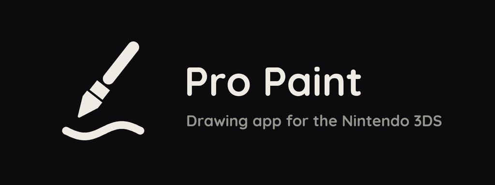
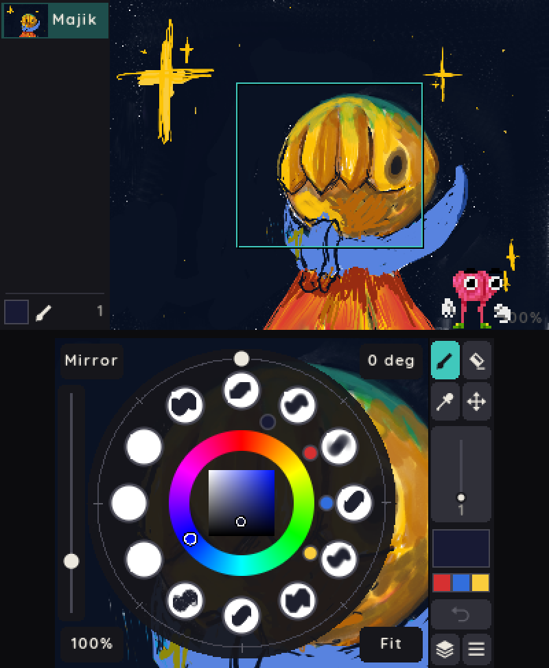
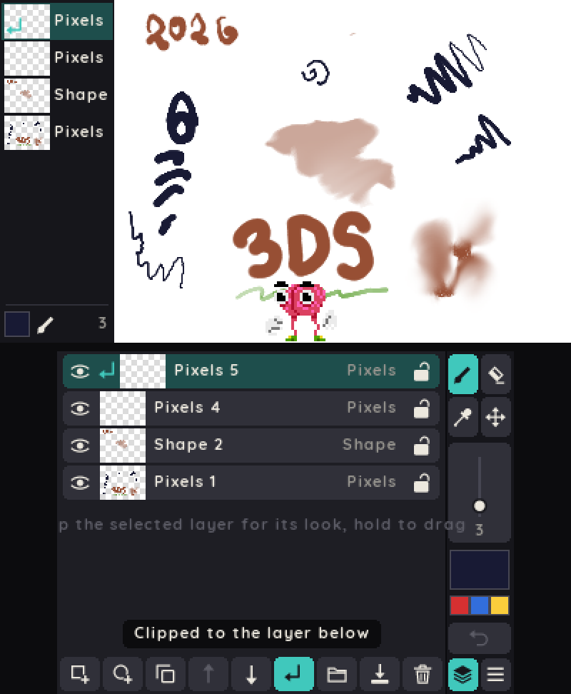
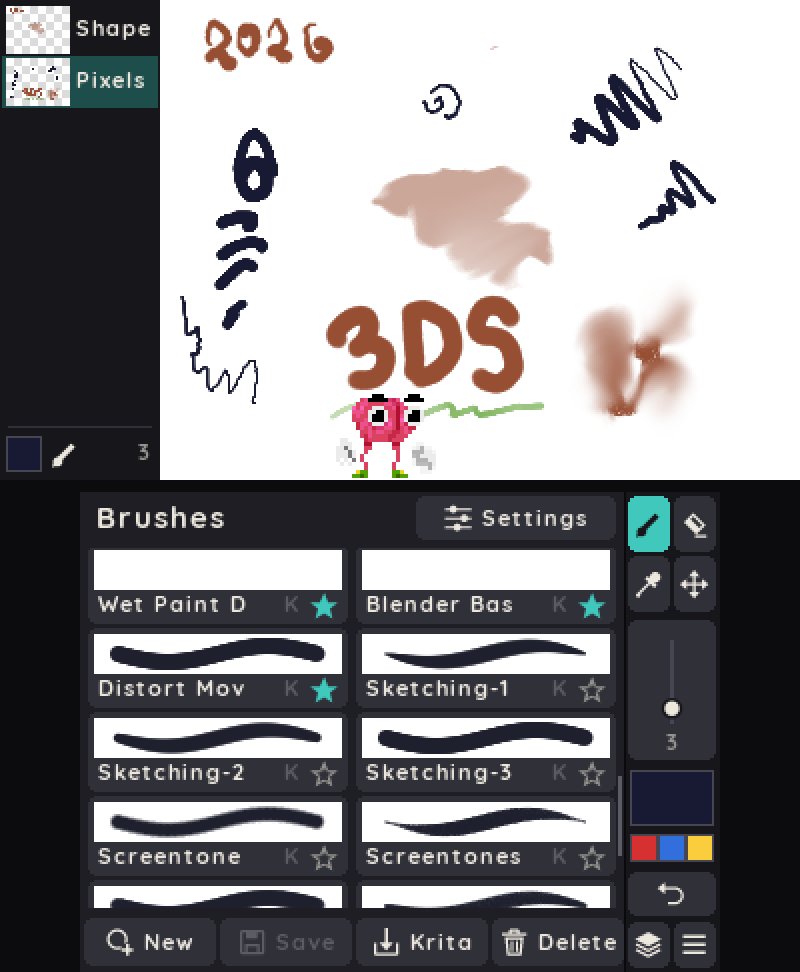
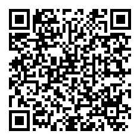

<p align="center"></p>

A layered drawing app for the Nintendo 3DS.

<p align="center">
  
  
  
</p>

## Install

You need a 3DS with [Luma3DS](https://github.com/LumaTeam/Luma3DS).

1. Open FBI.
2. Choose Remote Install, then Scan QR Code.
3. Scan this code.



Or download `propaint.cia` from [Releases](https://github.com/3DS-Pro-Media-Suite/propaint/releases/latest) and install it with FBI.
For the Homebrew Launcher, copy `propaint.3dsx` to `sdmc:/3ds/`.

## Features

- Up to 12 layers, with groups, clipping and blend modes.
- Shape layers stay sharp at any zoom.
- Stylus pressure on the New 3DS (needs Luma3DS).
- Comes with Krita brushes. Imports `.kpp` and `.bundle` files.
- Brush textures: paper, canvas and screentones from Krita, or your own PNG files.
- Smudge brushes can paint as they smudge, like wet paint.
- The eraser keeps its own brush and size.
- Export to PNG or layered OpenRaster (`.ora`).
- Saves on its own after 30 seconds without input.
- Cort, a mascot on the top screen. You can hide it.

## Controls

| Button | Action |
|---|---|
| Stylus | Draw |
| L, SELECT (ZR on a New 3DS) | Pop-up palette |
| A | Brush or eraser |
| Y (hold) | Pick a colour |
| Circle Pad | Move the page |
| ZL (hold, New 3DS) | Drag the stylus to move the page |
| D-pad left | Undo |
| B | Redo |
| START | Menu |

The table shows the right-handed buttons.
To change the buttons, press START and tap Stylus hand or Buttons.

## Files

| What | Where |
|---|---|
| Drawings (`.propaint`) | `sdmc:/Drawings` |
| Exports | `sdmc:/Drawings/Exports` |
| Brushes to import | `sdmc:/3ds/propaint/brushes` |
| Brush textures (PNG, up to 512 x 512) | `sdmc:/3ds/propaint/textures` |

FTP: press START and tap FTP server. It serves `sdmc:/Drawings` for download and delete.
There is no password, so use it only on a trusted network.

## Build

You need devkitPro with `3ds-dev`, `3ds-zlib` and `3ds-libpng`.

```sh
git clone --recursive https://github.com/3DS-Pro-Media-Suite/propaint
make        # propaint.3dsx
make cia    # propaint.cia, needs makerom and bannertool
```

`assets/` holds the source art and the Python scripts that convert it for the app.

## License

MIT. The Krita brushes and textures are CC0. The Quicksand font is under the SIL Open Font License. See `NOTICE`.
